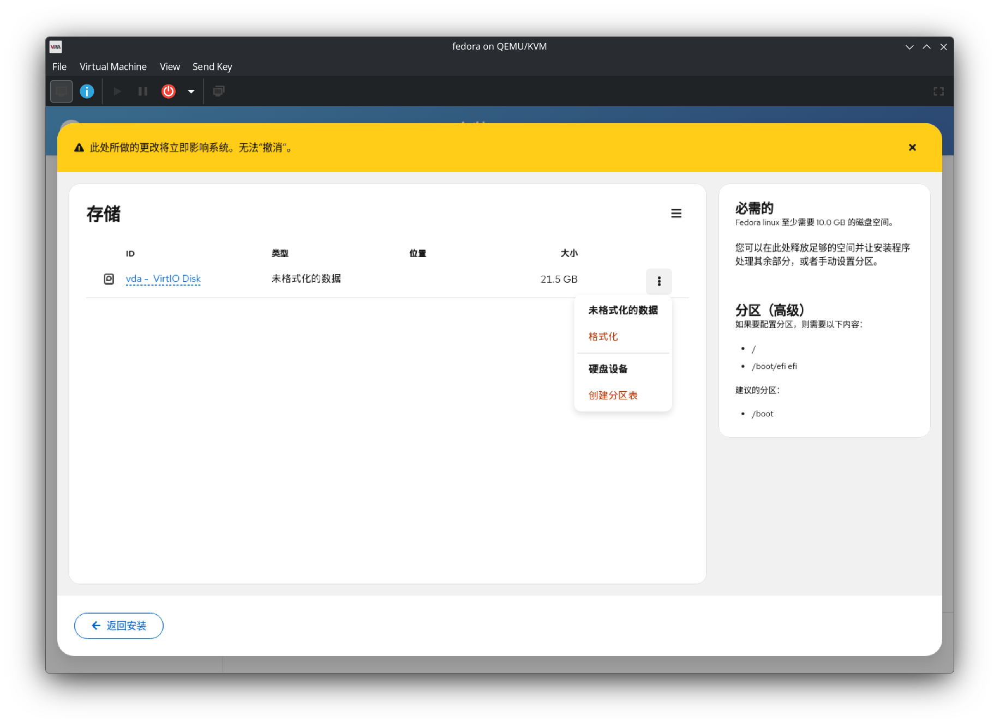
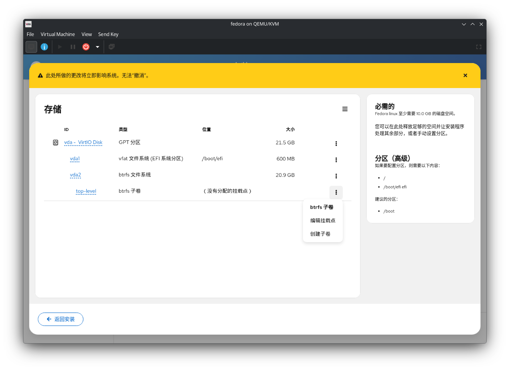
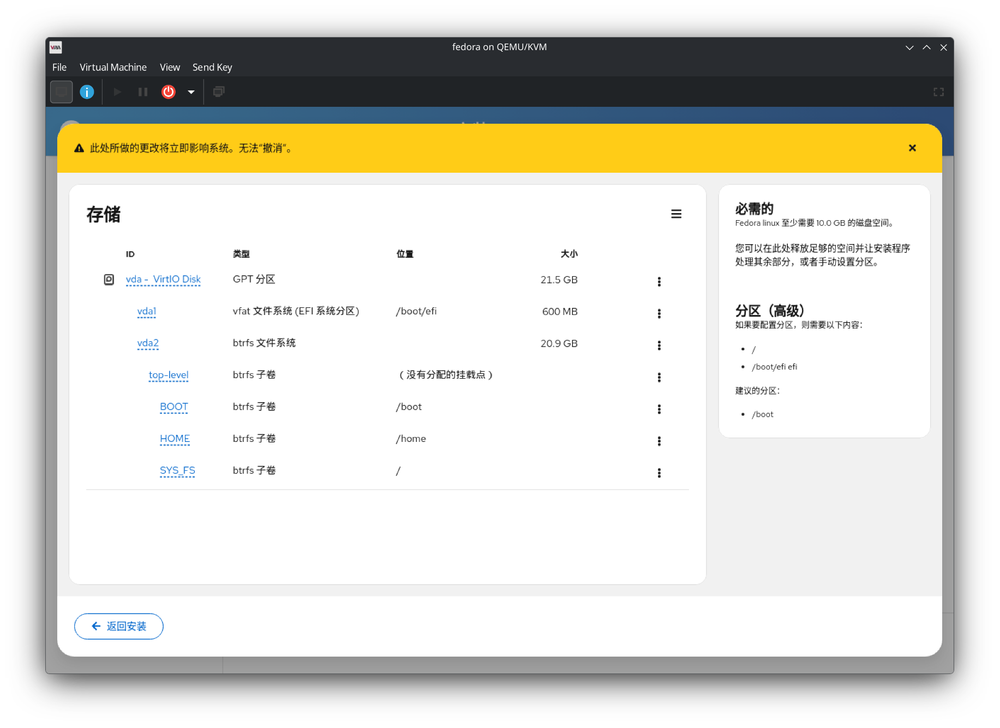
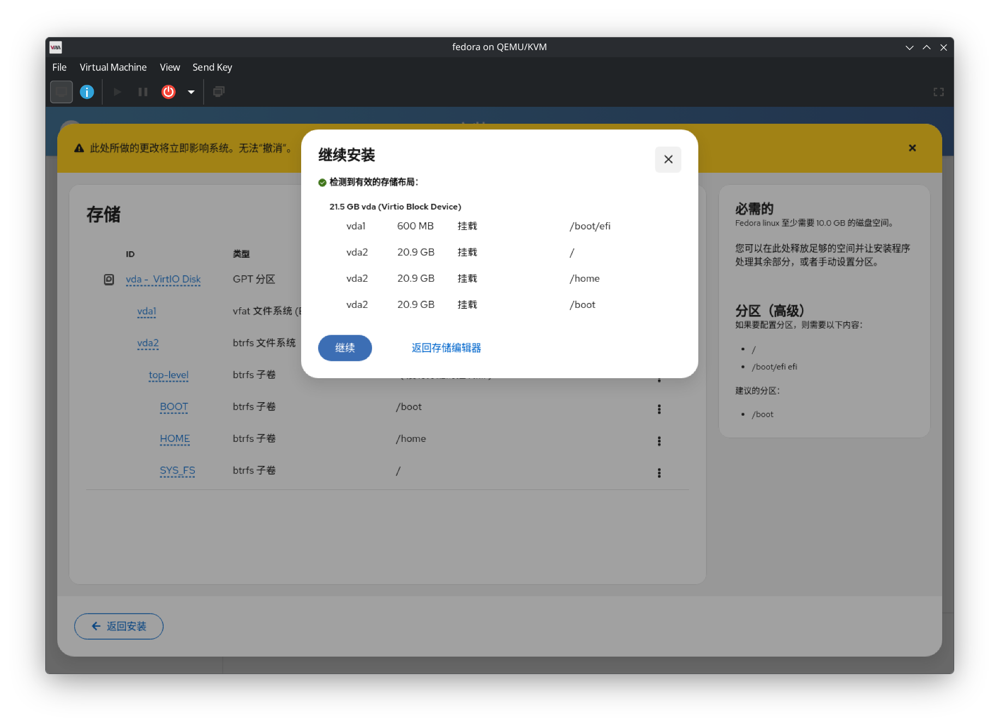
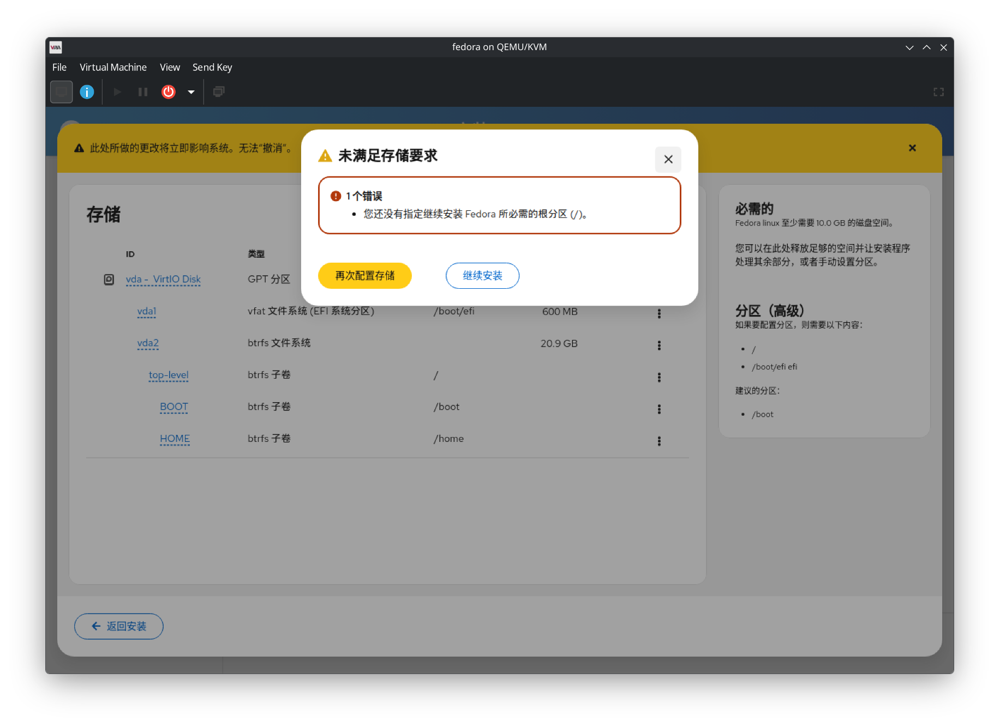
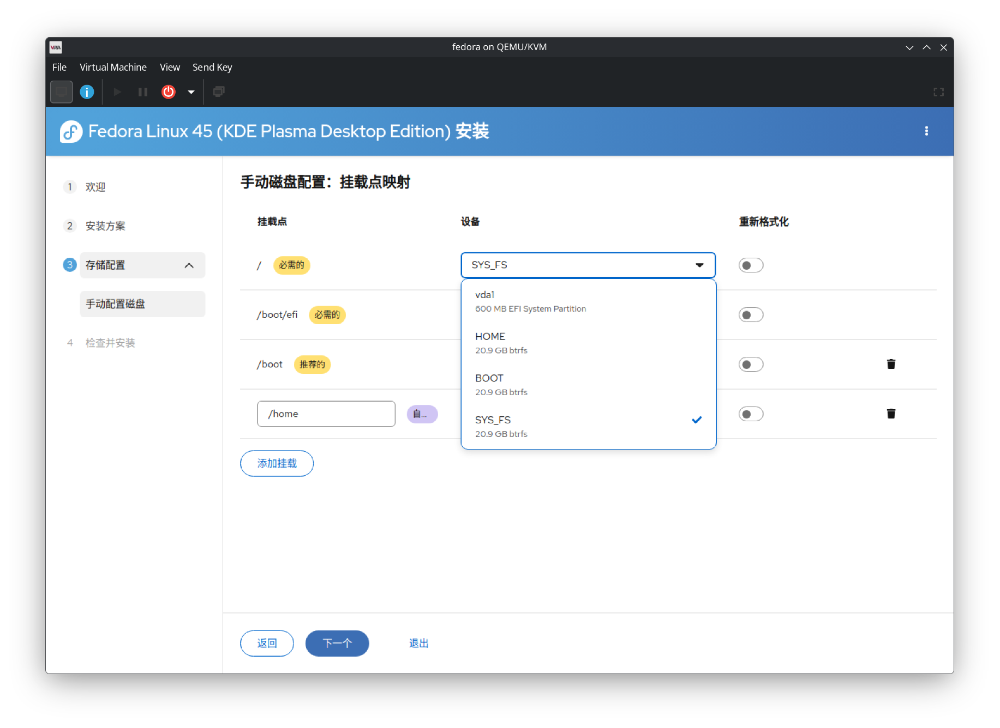
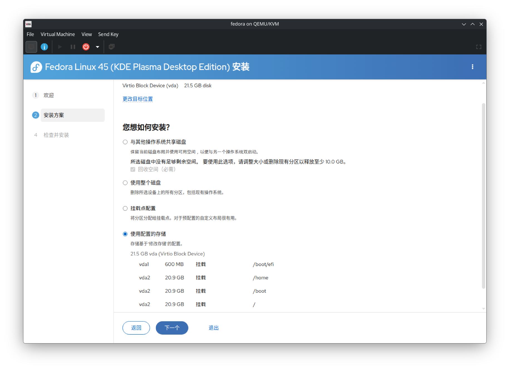

## 说明

- 本文描述：在安装系统时使用手动分区；
- 本文不描述：完整的安装流程及其他；
- 本文只使用 Fedora 默认的 btrfs 文件系统；
- 演示用的 ISO 版本为 Fedora 45，更新版本的 UI 可能会有所不同。

## 需要什么

一般地，要获得一个可正常工作的 Fedora Linux，至少需要两个磁盘分区：

1. [ESP] 或 [biosboot]
2. 根分区

[ESP]: https://wiki.archlinux.org/title/EFI_system_partition
[biosboot]: https://www.gnu.org/software/grub/manual/grub/html_node/BIOS-installation.html#BIOS-installation

对于 Fedora 45 及更新版本，安装器要求 ESP 应大于 500MiB。根据文档[^ref1]，根分区大小建议为 15GiB 及更大。

[^ref1]: https://docs.fedoraproject.org/en-US/fedora/latest/release-notes/hardware_overview/

当涉及 Windows-Linux 双系统时，如果不确定安装顺序，则建议先安装 Linux。如果颠倒顺序，需要参考 [ArchLinux Wiki 文档][dual-boot]重新配置 grub 以实现 dual-boot。

[dual-boot]: https://wiki.archlinux.org/title/GRUB#Detecting_other_operating_systems

**特别注意：** 
1. **不要让 Windows 和 Linux 共用同一个 ESP 分区。**
1. **使用存储编辑器对磁盘执行的操作会立即生效。**

## 手动创建分区表

启动 Fedora Installer，在第二步的安装方式中，选择 **使用存储编辑器创建自定义分区**。

如果此时选择的硬盘是完全空白的，则需要先创建分区表。对于 [UEFI] 设备，默认用 [GPT] 分区表；对于 [BIOS] 设备，优先使用 GPT 分区表（也可以使用 [MBR] 分区表）。

[GPT]: https://wiki.archlinux.org/title/Partitioning#GUID_Partition_Table
[MBR]: https://wiki.archlinux.org/title/Partitioning#Master_Boot_Record
[BIOS]: https://wiki.archlinux.org/title/GRUB#GUID_Partition_Table_(GPT)_specific_instructions
[UEFI]: https://wiki.archlinux.org/title/Unified_Extensible_Firmware_Interface

选择 [GPT] 分区表，需要使用 ESP；选择 [MBR] 分区表，需要一种叫 [biosboot]，大小至少为 1MiB 的空白分区（文件系统类型选择 **无文件系统**，并保持未格式化即可），建议磁盘上第一个分区创建为 `biosboot`。具体详见[文档][biosboot]。

然后在空闲区域创建两个新的分区：

- ESP 分区：挂载点为 `/boot/efi`，文件系统类型为 `EFI system partition`，大小要大于 500MiB。
- 根分区：不设置挂载点，文件系统类型为 `btrfs`，大小至少为 15GiB。

例如：

然后在新建的 btrfs 分区中，新建以下三个子卷：

- ROOT：用于挂载 `/`，是用于安装 Fedora 的子卷；
- HOME：用于存储用户文件的子卷；
    - 如果只是临时使用，不需要独立的 `/home` 子卷；
- BOOT：用于将 ESP 挂载至 `/boot`。

例如：

然后点击 **返回安装**，安装器会检查分区是否正确，如：

如前文所述，如果创建 btrfs 卷的同时给这个卷分配到 `/`，安装器就会报错，然后后续配置挂载点时，会缺少可用于安装系统的设备：

当然，如果有多余的自定义子卷，可以不重新修改分区，而是通过 **挂载点配置**，重新指定系统安装的位置，例如：

如果有子卷没有自动启用格式化（如上图的 `SYS_FS`），你可能需要手动启用。值得一提的是，如果有独立的 `/home` 子卷，重装系统时，不选择 **重新格式化**，则安装器就会保存 `/home` 子卷的数据。

需要注意的是，重装系统时，如果使用了相同的用户名，建议：

1. 使用 live 环境将 `/home/$USER` 重命名为其他名称；
2. 重命名完成后，需要卸载已挂载的分区，防止安装系统失败。

另外，重装系统时，可以选择直接挂载已有的子卷，然后选择性格式化子卷即可。

安装器会读取到配置正确的分区和挂载点，如：

此外，Fedora 默认使用 [ZRAM]，所以不需要额外创建一个单独的 [swap] 分区。当然，如果你需要，可以参考 [RHEL 文档] 给出的推荐配置。

[ZRAM]: https://wiki.archlinux.org/title/Zram
[swap]: https://wiki.archlinux.org/title/Swap
[RHEL 文档]: https://docs.redhat.com/en/documentation/red_hat_enterprise_linux/8/html/managing_storage_devices/getting-started-with-swap_managing-storage-devices#recommended-system-swap-space_getting-started-with-swap

如上，其他内容请参考万能的 archlinux wiki 和各处零散的 fedora 文档。